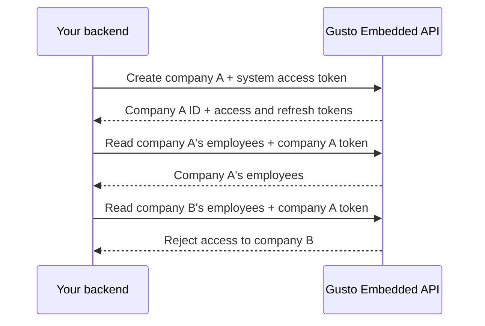

# Authentication

The SDK sends requests to the backend proxy configured by `GustoProvider`'s `config.baseUrl`. Your proxy authenticates the user in your application, authorizes their request, and forwards it to the Gusto Embedded API with a Gusto access token. The SDK does not acquire or refresh Gusto tokens.

## Gusto access tokens

Gusto tokens authorize your application's API access. They do not encode the permissions of the person signed in to your application.

| Token                     | Acts on behalf of                         | Use it for                                                                                                                 |
| ------------------------- | ----------------------------------------- | -------------------------------------------------------------------------------------------------------------------------- |
| System access token (SAT) | Your application                          | Application-level operations, such as creating a partner-managed company or subscribing to webhooks.                       |
| Company access token      | A specific company using your application | Company-level operations, such as accessing employees or submitting payroll, within your application's granted API scopes. |

Use a SAT for system-level operations and a company token for regular access to that company's resources. A company token cannot access another company. See the REST API's [Authentication and authorization guide](https://docs.gusto.com/embedded-payroll/docs/authentication-and-authorization) for obtaining, storing, and refreshing tokens, and [API scopes](https://docs.gusto.com/embedded-payroll/docs/api-fundamentals#scopes) for the operations your application may perform.

### Example: creating and accessing a company

Your backend uses a SAT to create a company and receives credentials for that company. Subsequent employee and payroll requests use its company token. Gusto enforces the company boundary even if your backend sends a request with the wrong company's token.

Keep Gusto access tokens, refresh tokens, and application credentials on your backend. Select a company token only after establishing that the authenticated user may access that company. Gusto's company boundary does not determine which resources that user may access within the company.

## Your application's users

Your proxy authenticates each session and establishes its company and permissions. The company determines which Gusto token to use; the session's permissions determine which requests to forward.

For example, an administrator and an employee completing self-onboarding may use the same company token. The token permits your application's company-level operations, but your proxy should allow each person only the actions and resources your application authorizes for them. Your application also uses those permissions to decide which SDK components to display. See [Proxy security](./proxy-security-partner-guidance.md) for examples of mapping session permissions to components and API requests.

## Connecting the SDK to your proxy

Set `GustoProvider`'s `config.baseUrl` to your proxy's address. Use your application's authentication mechanism to identify the user making each request. If that mechanism requires request headers, the SDK supports static headers through `config.headers` and headers computed at request time through [request interceptors](../guides/integration-guide/request-interceptors.md). These browser-side headers authenticate requests to your proxy; supply Gusto credentials only on the backend request to the API.

Your proxy forwards the authorized request and returns the API response to the SDK. Add the `x-gusto-client-ip` header using a client IP established by your backend; signature workflows require it. We also recommend forwarding the SDK's `X-Gusto-SDK-Version` request header so Gusto can identify the SDK version when investigating API traffic.

The [demo application](./example-app.md) provides a runnable example of token management and forwarding. Its proxy does not currently implement user authentication or authorization.
