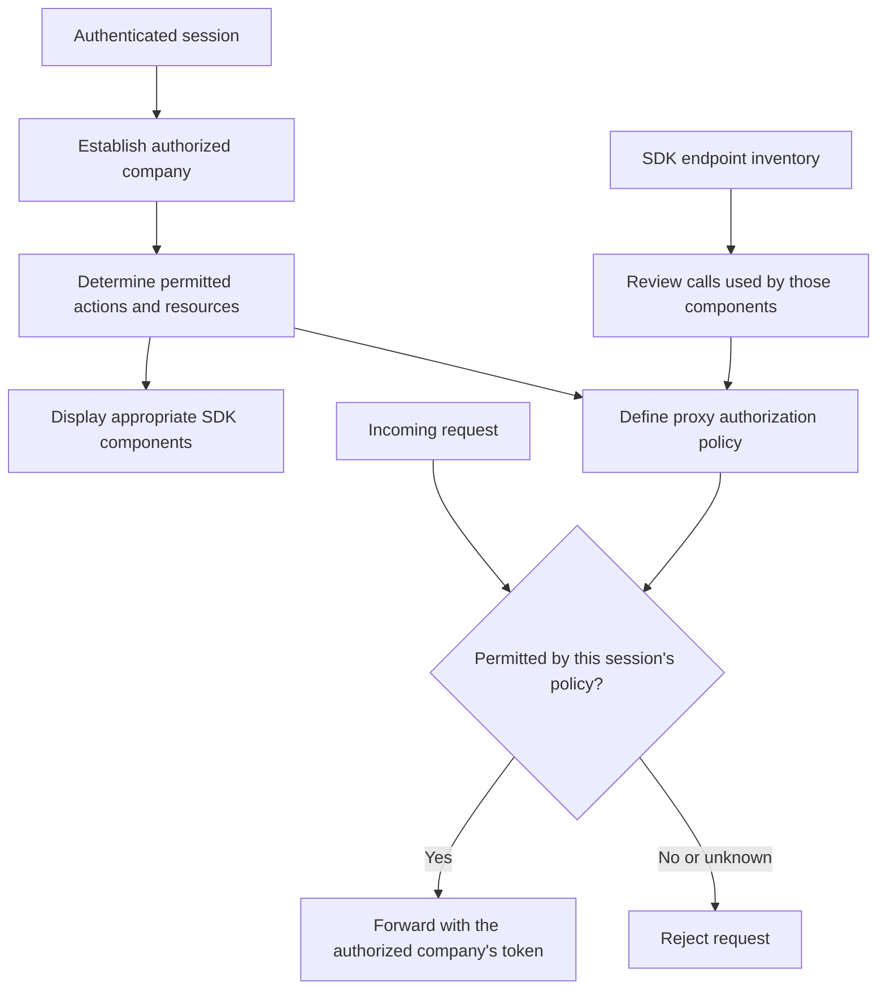
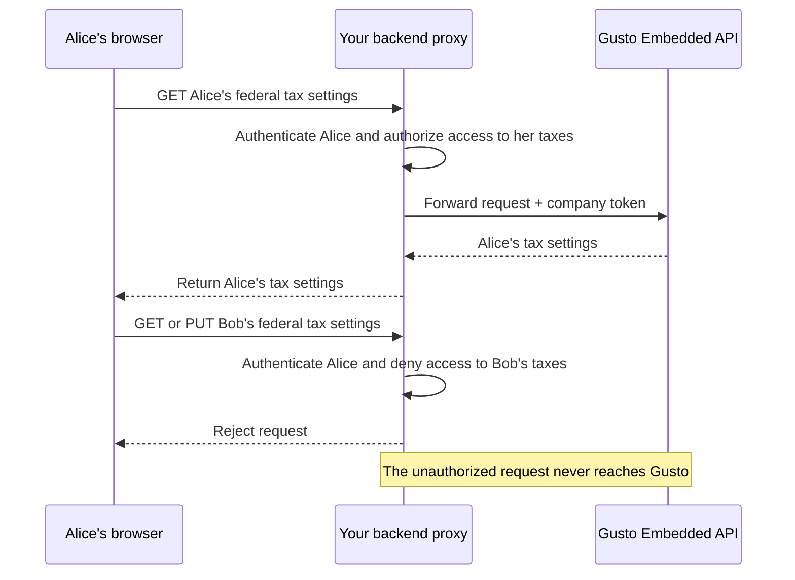

# Proxy security

A Gusto company access token authorizes API calls on behalf of a company. Your application decides which people may use SDK components and which actions they may perform. Your backend proxy must enforce those decisions before forwarding requests with the company token. See [Authentication](./authentication.md) for the distinction between application users and Gusto tokens.

## Start with the session's permissions

Authenticate the user on every request to your proxy. Establish which company they may access and which actions and resources they may access within it. Use those permissions both to choose the SDK components they see and to decide whether to forward requests with that company's token. Reject requests when you cannot establish permission.

Your application's permission model is the source of truth. The inventory helps you identify the API calls needed to support those permissions. Component visibility does not enforce API access: users can change identifiers or send requests directly to your proxy without using a component.

## Match component access to request access

If every user has full administrative access to their authorized company, the policy can be relatively simple. Every request still requires authentication and verification of company access. You may also restrict the proxy to the endpoints your integration uses, limiting what a compromised session can do with your company's token.

For users with restricted access, define both the actions they may perform and the resources they may act on. Employee or contractor self-onboarding, for example, should not grant access to payrolls or other people's data.

The examples below illustrate permissions your application might grant. They are not built-in SDK roles or complete allowlists.

| Session permissions                                           | Components to display                                                               | Requests the proxy may forward                                                                                                                    |
| ------------------------------------------------------------- | ----------------------------------------------------------------------------------- | ------------------------------------------------------------------------------------------------------------------------------------------------- |
| Full administrator for company A                              | The company, employee, contractor, and payroll components your integration supports | The methods and endpoints needed for those capabilities, restricted to company A and its resources.                                               |
| Employee Alice completing her own onboarding at company A     | Employee self-onboarding components for Alice                                       | Requests needed for Alice's onboarding, including reading and updating her tax settings. Deny access to Bob's employee data and company payrolls. |
| Contractor Casey completing their own onboarding at company A | Contractor self-onboarding components for Casey                                     | Requests needed for Casey's onboarding, including reading and updating their profile. Deny access to other contractors and company payrolls.      |

Review the inventory for the components you display to identify their API calls, then decide which calls are appropriate for each session. A component may support multiple capabilities: for example, the contractor profile's endpoint list includes creating a contractor as well as reading and updating one. Displaying it to an existing contractor does not grant permission to create other contractors.

For a session permitted to edit only its own details, the distinction can be as specific as:

| Session          | Endpoint and requested resource                  | Decision                                                                |
| ---------------- | ------------------------------------------------ | ----------------------------------------------------------------------- |
| Employee Alice   | `GET` or `PUT /v1/employees/ALICE/federal_taxes` | Forward if Alice is permitted to read or update her own taxes.          |
| Employee Alice   | `GET` or `PUT /v1/employees/BOB/federal_taxes`   | Deny: the requested employee is outside Alice's permissions.            |
| Contractor Casey | `GET` or `PUT /v1/contractors/CASEY`             | Forward if Casey is permitted to read or update their own profile.      |
| Contractor Casey | `POST /v1/companies/COMPANY-A/contractors`       | Deny: editing Casey's own profile does not permit creating contractors. |

Check resources identified in the request path, query, or body as appropriate for the API operation. For an address or a form, establish its relationship to the authorized employee or company before permitting access. Some onboarding requests also read company information, such as work locations; authorize those supporting requests deliberately rather than granting broad company access.

### Example: the same endpoint, different permissions

Alice and Bob work at the same company. Your application grants Alice access to her own tax settings. Both employees' tax endpoints are reachable with the company token, but your proxy should forward only Alice's authorized request.

The same check is necessary whether Alice uses an SDK component or sends the request directly. Allowlisting the tax endpoint alone would admit both requests; authorization must account for the requested employee and action.

## Use the endpoint inventory as a reference

The SDK publishes `@gusto/embedded-react-sdk/endpoint-inventory.json`, a generated inventory of the API endpoints its components and hooks use. You can also read the [endpoint reference tables](../guides/endpoint-reference.md) and endpoint lists on individual [reference pages](../reference/index.mdx). Use these lists to review reasonable requests for a session after determining its permissions.

An endpoint allowlist can restrict requests to known methods and paths. It does not by itself establish permission to access the requested resource. Review changes when upgrading the SDK; a newly listed endpoint does not automatically belong in a session's permitted requests.

If you use inventory paths in an allowlist, consult each block or hook's `variables` metadata. Names are not uniform: employee identifiers may be called `employeeId` or `employeeUuid`, and company identifiers may be called `companyId` or `companyUuid`. Binding one name does not bind the other. Every placeholder needs an explicit rule:

- Bind resource identifiers to authorized values, or check access to the requested resource before forwarding.
- Restrict non-resource values, such as `state` or `documentType`, to permitted values.
- Reject missing bindings or authorization rules. Never automatically turn an unresolved placeholder into a wildcard. Any intentional wildcard must constrain accepted values and preserve the resource authorization checks.

Verify that your proxy rejects unauthorized actions and requests for other users' resources. Record authorization decisions and proxied actions for auditing without logging credentials or sensitive request and response bodies.

## Working proxy example

The [demo application's proxy](https://github.com/Gusto/embedded-react-sdk-demo-app/blob/main/backend/src/proxy.ts) demonstrates token management and request forwarding. It does not currently implement user authentication, endpoint allowlisting, or user-level authorization. Implement those controls before using a proxy for real users.

For browser policies governing SDK styles and embedded documents, see [Content Security Policy](../guides/integration-guide/content-security-policy.md).
