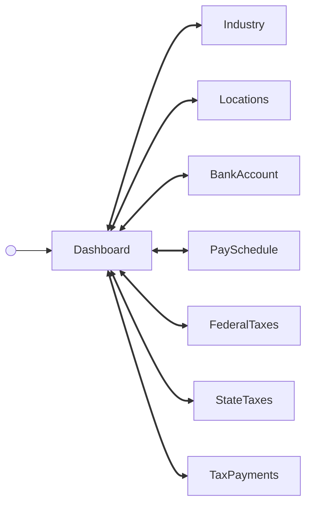

<!-- Partner-facing guide content, published to the SDK docs site. -->

# DashboardFlow

## Tabs <!-- slot: overview -->

The dashboard organizes a company's settings into tabs. Switching tabs emits `company/dashboard/tabChange`.

- **Company details** — the industry classification (title and NAICS code) and the company's work addresses, with their mailing and filing designations.
- **Pay** — the company's pay schedules and its funding bank account. The bank account card shows the name, masked account number, routing number, account type, and micro-deposit verification status; Gusto supports one default company bank account, so this is a single account rather than a list. The pay schedules card lists each schedule with its frequency and names how employees are assigned to them.
- **Taxes** — federal tax details (legal name, tax payer type, federal filing form, and whether an EIN is on file and verified), above one row per state the company has tax requirements in, each with its setup status, and what the company currently owes its tax agencies.

The EIN itself is never returned by the API, so the Federal taxes card reports verification status rather than the number.

The pay schedules card requires the `managePaySchedules` unstable feature flag in addition to `companySettingsDashboard`. With `managePaySchedules` off the card is omitted and the Pay tab shows the bank account alone. The card names the assignment mode — one schedule for all employees, separate hourly and salaried schedules, per employee, or per department — rather than the mapping itself, which needs the full employee roster to resolve.

The tax payments card requires the `taxPayments` unstable feature flag in addition to `companySettingsDashboard`. With `taxPayments` off the card is omitted and the Taxes tab shows the federal and state cards alone. The card reports how many payments are past due and the total they come to, then names the next payment still owing — its due date, agency, jurisdiction, and amount. It does not list the ledger; the full searchable history is behind its Manage action.

A tax payment has no status field in the API, so overdue is derived from each payment's amounts and dates. The card derives it over two date-bounded windows around today rather than the company's whole history: the 100 most recently due payments and the next 25 coming due. A company with more unpaid history than that window reads as having at least that many payments overdue. Payments the API returns no due date for are not reported on the card.

## Step flow <!-- slot: appendix -->

The dashboard is a hub: the `Dashboard` cards view is the resting state. A card's Edit or Manage CTA opens that section's component, and a "Back to company settings" header returns to the cards. A successful save shows a dismissible success alert.

Each spoke is a complete component rather than a single form, so it may have screens of its own — `Locations`, for example, has its own address list with add and edit screens. Events raised inside a spoke (`company/location/add/done`, `company/bankAccount/created`, `company/bankAccount/verified`, `company/federalTaxes/updated`, `company/stateTaxes/edit`, `company/stateTaxes/updated`) keep the spoke open; only the spoke's own completion event (`company/location/done`, `company/bankAccount/done`, `company/federalTaxes/done`, `company/industry/selected`, `company/stateTaxes/done`) or the back header returns to the dashboard.

`PaySchedule` is a hub in its own right and has no completion event at all: its schedule form, employee assignment wizard, and AutoPilot dialog each return to its own overview, and it shows its own success alerts rather than the dashboard's. The back header is the only way from it to the dashboard.

`TaxPaymentsFlow` is likewise a hub with no completion event, and being read-only it has nothing to show a success alert about: `company/taxPayments/view` and `company/taxPayments/back` move between its list and a single payment's detail, both inside the spoke. The back header is the only way from it to the dashboard.

Because `Industry` and `FederalTaxes` submit without a Cancel button, and `Locations` and `BankAccount` open directly into a form when the company has no record yet, the "Back to company settings" header is the reliable way out of any spoke. It emits `company/dashboard/back`.

`PaySchedule` accepts two behaviors that `DashboardFlow` forwards: `enableAutoPilot` adds the AutoPilot row and its Edit action, and `enableMultipleSchedules` adds the Manage action that opens employee assignment. Both default to off, which leaves the pay schedule screen showing a single schedule's name and frequency with an Edit action.

Some actions stay on the cards view without a screen swap: switching tabs (`company/dashboard/tabChange`) and dismissing a success alert (`company/dashboard/alertDismissed`).

`StateTaxes` has two levels of its own: a list of states, and per state either a requirements form or a tax rate history view. Moving between them raises `company/stateTaxes/edit` and `company/stateTaxes/manageRates`, and saving a state raises `company/stateTaxes/updated` — all of which keep the spoke open, since a company is rarely done after one state.

## Empty states <!-- slot: appendix -->

Each card handles missing data on its own: the Industry card shows "No industry selected" until a NAICS code is saved, the Locations card shows "No locations yet" until the first address is added, and the Bank account and Pay schedules cards swap their Manage CTA for "Add bank account" and "Add pay schedule" until a record exists. Opening a section from its empty state lands on the screen that creates the missing record — `PaySchedule` opens its create form directly when the company has no schedule.

The State taxes card is empty until the company has a work address in a state, since state tax requirements follow from where employees work. Adding the first address on the Company details tab is what populates it.

The Tax payments card shows "No tax payments scheduled" when nothing is outstanding — which covers both a company that has never owed payroll taxes and one that has settled everything it owes.
