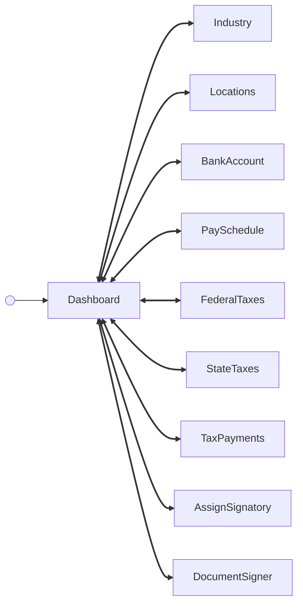

<!-- Partner-facing guide content, published to the SDK docs site. -->

# DashboardFlow

## Tabs <!-- slot: overview -->

The dashboard organizes a company's settings into tabs. Switching tabs emits `company/dashboard/tabChange`.

- **Company details** — the industry classification (title and NAICS code) and the company's work addresses, with their mailing and filing designations.
- **Pay** — the company's pay schedules and its funding bank account. The bank account card shows the name, masked account number, routing number, account type, and micro-deposit verification status; Gusto supports one default company bank account, so this is a single account rather than a list. The pay schedules card lists each schedule with its frequency and names how employees are assigned to them.
- **Taxes** — federal tax details (legal name, tax payer type, federal filing form, and whether an EIN is on file and verified), above one row per state the company has tax requirements in, each with its setup status, and what the company currently owes its tax agencies.
- **Documents** — who is authorized to sign the company's forms, and the forms themselves.

The EIN itself is never returned by the API, so the Federal taxes card reports verification status rather than the number.

The pay schedules card requires the `managePaySchedules` unstable feature flag in addition to `companySettingsDashboard`. With `managePaySchedules` off the card is omitted and the Pay tab shows the bank account alone. The card names the assignment mode — one schedule for all employees, separate hourly and salaried schedules, per employee, or per department — rather than the mapping itself, which needs the full employee roster to resolve.

The tax payments card requires the `taxPayments` unstable feature flag in addition to `companySettingsDashboard`. With `taxPayments` off the card is omitted and the Taxes tab shows the federal and state cards alone. The card reports how many payments are past due and the total they come to, then names the next payment still owing — its due date, agency, jurisdiction, and amount. It does not list the ledger; the full searchable history is behind its Manage action.

A tax payment has no status field in the API, so overdue is derived from each payment's amounts and dates. The card derives it over two date-bounded windows around today rather than the company's whole history: the 100 most recently due payments and the next 25 coming due. Because the endpoint cannot filter on a status it does not store, those windows hold the most recently due payments whatever their status — already-settled ones included. The overdue count is therefore a floor rather than a total for a company with more past-due payments than the window holds, and an overdue payment sitting behind a full window of more recent settled ones is not reported at all. The full ledger is always available through Manage. Payments the API returns no due date for are not reported on the card.

The signatory card names the person authorized to sign for the company — their name, title, email, and identity verification status. A company has at most one signatory, so this is a single person rather than a list. Identity verification is what determines whether they can sign: a verified signatory can sign every form, a failed one cannot sign at all, and a skipped one cannot sign Form 8655 until a wet-signed copy is uploaded. A signatory who has not finished verification reads as pending.

The documents card reports how many forms are awaiting signature and names them, above the size of the company's document set. It does not list that set, which grows with every tax filing — the full list is behind its Manage action. A form carries no signed-on date: the API models signing state as a `requires_signing` flag that flips once the form is signed, so the card reports what is outstanding rather than a signing history.

Signing a company form requires knowing who is looking at the dashboard. Pass `viewerSignatoryId` with the identifier of the signatory using it, and the documents screen offers a Sign action for each outstanding form. Leave it unset and that screen is review-only: every form can be opened and the signatory can be changed, but outstanding forms read as "Not signed" with no Sign action. Changing the signatory from that screen does not lift this — signing stays bound to `viewerSignatoryId`. The dashboard never infers this from the company's saved signatory — doing so would treat anyone who opens the dashboard as the signatory and let them sign the company's federal tax forms.

## Step flow <!-- slot: appendix -->

The dashboard is a hub: the `Dashboard` cards view is the resting state. A card's Edit or Manage CTA opens that section's management surface, and a "Back to company settings" header returns to the cards. A successful save shows a dismissible success alert.

Each section is also available on its own, as a card paired with a block that switches between the card and its editor — `CompanyManagement.Industry`, `CompanyManagement.Locations` and so on. Those blocks are not used here: the dashboard composes the cards directly, so a card's CTA routes within the dashboard rather than opening a second, nested editor with its own back affordance.

Each spoke is a complete surface rather than a single form, so it may have screens of its own — Locations, for example, has its own address list with add and edit screens.

Every spoke raises a `company/management/<section>/updated` event when something is saved, and the dashboard acts only on that. The underlying screens keep raising their own events too (`company/location/add/done`, `company/bankAccount/created`, `company/bankAccount/verified`, `company/federalTaxes/updated`, `company/industry/selected`, `company/stateTaxes/updated`, `company/stateTaxes/rateScheduled`, `company/forms/sign/signForm`, and so on), so anything already listening for them keeps working — they simply no longer drive navigation.

For the single-form sections — Industry, Federal taxes and Signatory — a save returns to the cards with an alert. For the sections where several records are edited in one visit — Locations, Bank account, State taxes and Documents — a save keeps the spoke open and the alert surfaces once you leave, since a company rarely stops after one address, one state or one form.

The documents spoke is a hub too, and the one case where a spoke contains a screen the dashboard also reaches directly: changing the signatory from the document list opens its own assign-signatory screen, which raises the same `company/signatory/assignSignatory/done` the Signatory spoke's screens raise. Only saves made through the Signatory spoke raise `company/management/signatory/updated`, so changing the signatory mid-review returns you to the document list rather than to the cards. Signing is the same: a company signs its forms one at a time, so each signature keeps the screen open and the "Documents signed" alert surfaces only once you leave.

`AssignSignatory` offers two routes to the same outcome — fill in the signatory's details directly, or invite them to supply their own — and `company/signatory/assignSignatory/done` fires for both, which is why the dashboard returns on that event rather than on the create and invite events behind it. The signatory card's `company/management/signatory/editRequested` carries the current `signatoryId` so the spoke amends that record; assigning someone new from the empty state carries no identifier and creates one.

`PaySchedule` is a hub in its own right and has no completion event at all: its schedule form, employee assignment wizard, and AutoPilot dialog each return to its own overview, and it shows its own success alerts rather than the dashboard's. The back header is the only way from it to the dashboard.

`TaxPaymentsFlow` is likewise a hub with no completion event, and being read-only it has nothing to show a success alert about: `company/taxPayments/view` and `company/taxPayments/back` move between its list and a single payment's detail, both inside the spoke. The back header is the only way from it to the dashboard.

The "Back to company settings" header is the way out of every spoke, and for most of them the only one: the management surfaces drop the Continue button their onboarding counterparts carry, since there is nothing to continue to from a settings page. Industry, Federal taxes and the signatory screens submit without a Cancel button of their own, and Locations and Bank account open directly into a form when the company has no record yet. The header emits `company/dashboard/back`.

Cancelling inside a spoke is separate: it returns you to that spoke's own list — one address form, one state, or the micro-deposit screen — not to the cards.

`PaySchedule` accepts two behaviors that `DashboardFlow` forwards: `enableAutoPilot` adds the AutoPilot row and its Edit action, and `enableMultipleSchedules` adds the Manage action that opens employee assignment. Both default to off, which leaves the pay schedule screen showing a single schedule's name and frequency with an Edit action.

Some actions stay on the cards view without a screen swap: switching tabs (`company/dashboard/tabChange`) and dismissing a success alert (`company/dashboard/alertDismissed`).

`StateTaxes` is a hub too, with two levels of its own: a list of states, and per state either a requirements form or a tax rate history view. Moving between them raises `company/stateTaxes/edit` and `company/stateTaxes/manageRates`, saving a state raises `company/stateTaxes/updated`, and scheduling a future-dated rate raises `company/stateTaxes/rateScheduled` — all of which keep the spoke open, since a company is rarely done after one state. The state list has no Continue button, so the back header is the only way from it to the dashboard; the "State tax settings updated" alert surfaces then, if a state was saved or a rate scheduled during the visit.

The tax rate history lists a state's past, current, and scheduled rates. A new rate can be scheduled only for one of the effective dates the state accepts, which the API supplies. A scheduled rate cannot be cancelled from the dashboard: the tax requirements API has no operation for removing one.

## Empty states <!-- slot: appendix -->

Each card handles missing data on its own: the Industry card shows "No industry selected" until a NAICS code is saved, the Locations card shows "No locations yet" until the first address is added, and the Bank account and Pay schedules cards swap their Manage CTA for "Add bank account" and "Add pay schedule" until a record exists. Opening a section from its empty state lands on the screen that creates the missing record — `PaySchedule` opens its create form directly when the company has no schedule.

The State taxes card is empty until the company has a work address in a state, since state tax requirements follow from where employees work. Adding the first address on the Company details tab is what populates it.

The Tax payments card shows "No tax payments scheduled" when nothing is outstanding — which covers both a company that has never owed payroll taxes and one that has settled everything it owes.

The Signatory card shows "No signatory assigned" and swaps its Edit CTA for "Assign signatory" until someone is named. Opening it from that state lands on the assign screen, which starts on the direct-entry form.

The Documents card shows "No company documents yet" until Gusto generates the company's first forms. Opening the documents screen before a signatory exists lands on its own assign-signatory screen first, since nothing can be signed without one.
