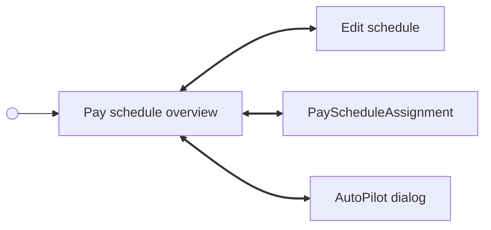

# Companies

## Manage pay schedules <!-- slot: appendix -->

[CompanyManagement.PaySchedule](./management/blocks.md#payschedule) manages schedules after onboarding. It displays the company's current assignment, opens schedule editing, and returns to the overview after a save. With no schedules, it opens schedule creation directly. Both `enableMultipleSchedules` and `enableAutoPilot` default to `false`; enable them to show Manage and AutoPilot controls. Existing assignments still determine the overview when these controls are hidden.



[CompanyManagement.PayScheduleAssignment](./management/blocks.md#payscheduleassignment) can also be mounted directly. Handle `paySchedule/management/assignment/assigned` and `paySchedule/management/assignment/cancel` to close it. These events bubble to your handler; they do not navigate away from the standalone component.

Assignment supports:

| Mode | Behavior |
| --- | --- |
| `single` | One schedule for all employees. |
| `hourly_salaried` | Separate schedules for hourly and salaried employees. |
| `by_department` | Department schedules plus a default for employees without a department. |
| `by_employee` | Individual employee schedules. |

Existing selections populate the flow. Back navigation and nested schedule creation retain selections. Changing the assignment type clears selections from the previous type. Using the same schedule for every group submits a `single` assignment.

Department assignment requires department read access. Employee assignment requires employee and compensation read access and a current, onboarded roster. Terminated, historical, incomplete-onboarding, and missing-compensation employees are excluded. Missing access produces a warning and prevents selecting the affected mode; existing restricted assignments cannot be continued until access is restored. Other request failures use the component's error boundary.

### Copy overrides

`PaySchedule.dictionary` accepts namespace-keyed overrides for its overview and AutoPilot dialog. Missing keys use SDK defaults. These overrides do not configure the assignment or schedule creation form. A directly mounted `PayScheduleAssignment` accepts its own dictionary for `Company.Management.PayScheduleAssignment`; the shared schedule form uses `Company.PaySchedule`.

```tsx
import { CompanyManagement } from '@gusto/embedded-react-sdk'

export function ManagePaySchedules({ companyId, onEvent }: {
  companyId: string
  onEvent: CompanyManagement.PayScheduleProps['onEvent']
}) {
  return (
    <CompanyManagement.PaySchedule
      companyId={companyId}
      onEvent={onEvent}
      enableAutoPilot
      enableMultipleSchedules
      dictionary={{
        en: {
          'Company.Management.PaySchedule': { title: 'Payroll schedules' },
          'Company.Management.AutoPilotDialog': { saveCta: 'Save AutoPilot settings' },
        },
      }}
    />
  )
}
```

AutoPilot checks eligibility before enabling. Blockers or a failed eligibility request prevent enabling; an already enabled schedule can be disabled. Saving without changing the toggle dismisses the dialog without updating the schedule.

### Transition payrolls

The assignment review previews affected employees and their transition pay periods. Saving assignments does not run those payrolls. Use [Payroll.PayrollFlow](../payroll/payroll-flow.md) to run transition payrolls surfaced by the payroll landing screen. For custom routing, [Payroll.TransitionConfiguration](../payroll/blocks.md#transitionconfiguration) documents how to obtain an existing transition payroll ID and continue to execution. The assignment completion event contains employee changes and the assignment selections, rather than a transition payroll ID.
