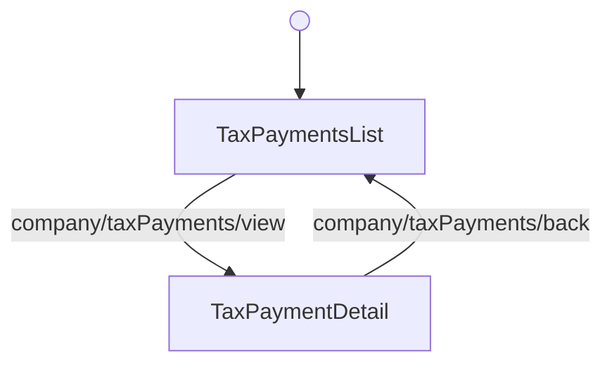

<!-- Partner-facing guide content, published to the SDK docs site. -->

# TaxPaymentsFlow

## Step flow <!-- slot: appendix -->

`TaxPaymentsFlow` centers on `TaxPaymentsList` as its hub. Selecting a payment (`company/taxPayments/view`) opens `TaxPaymentDetail`, and the back button (`company/taxPayments/back`) returns to the list.

The flow has no terminal step. Unmount it when you no longer need it.

## Current limitations <!-- slot: appendix -->

While this flow is in alpha, note the following:

- **Requires the `tax_payments:read` OAuth scope.** Without it every request returns an authorization
  error.
- **The table cannot be sorted by column.** Payments are always ordered by due date, newest first.
- **Tax liabilities are labeled with a tax code**, not a human-readable tax name. The API exposes
  only the code.
- **Status is derived, not reported.** The API has no status field, so `Paid`, `Scheduled`,
  `Overdue`, and `Refund / Credit` are computed from each payment's amounts and dates. A payment that
  was sent and then returned or cancelled is indistinguishable from one that was never sent, and both
  read as `Scheduled` or `Overdue`.
- **Only the most recent payments are listed.** Companies with a long history may not see their
  oldest payments; the list shows a notice when that happens.
