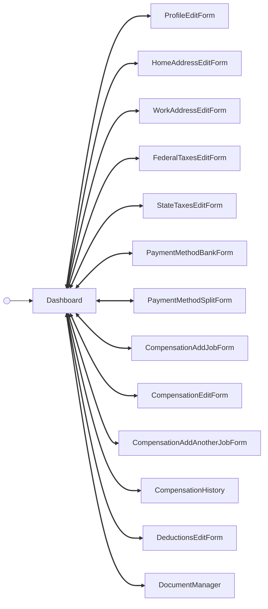

<!-- Partner-facing guide content, published to the SDK docs site. -->

# DashboardFlow

## Tabs <!-- slot: overview -->

The dashboard organizes an employee's payroll information into four tabs. Switching tabs emits `employee/dashboard/tabChange`.

- **Basic details** — legal name, start date, SSN, date of birth, and personal email, plus home address and work address cards. Fields are read-only with "Edit"/"Manage" CTAs.
- **Job and pay** — compensation (one job, or a table of jobs when the primary job is nonexempt), payment method (direct-deposit bank accounts), deductions (garnishments), and paystub history. Lists paginate.
- **Taxes** — federal tax withholding (supports both pre-2020 and Rev 2020 W-4 versions, so the visible fields vary with the W-4 on file) and per-state tax withholding records.
- **Documents** — a read-only table of employee forms (W-2s, W-4s, direct-deposit authorizations, and other documents) with a "View" CTA per row.

The compensation card's "View history" CTA requires the `compensationHistory` unstable feature flag. With the flag off the CTA is omitted and the card is otherwise unchanged. With it on, the CTA opens a read-only view of every effective-dated compensation the employee has — one table per job, newest effective date first, listing each rate's effective date, job title, employee type, and wage. The rate in effect today is badged "Current" and a scheduled future-dated rate is badged "Upcoming"; past rates carry no badge. A job the employee has not started yet has no current row, so every one of its rates reads as upcoming.

Each row is the rate that took effect on its date, not a date range: the API returns no end date for a compensation and no reason for the change, so a rate's end is implied by the effective date of the row above it. Job titles are resolved as of each rate's own effective date, which is why a row can carry a different title from the one the card shows.

## Step flow <!-- slot: appendix -->

The dashboard is a hub: the `Dashboard` cards view is the resting state. A card's edit/manage CTA opens that section's edit form; submitting or cancelling returns to the cards, and a successful save shows a dismissible success alert. The documents card is the exception — its View CTA opens `DocumentManager`, a read-only viewer that returns on Back; signing happens during employee onboarding, not here. `CompensationHistory` is read-only in the same way, and returns to the cards on Back.

Some actions stay on the cards view without a screen swap: switching tabs (`employee/dashboard/tabChange`), dismissing a success alert (`employee/dismiss`), and deleting a bank account or deduction.

## Empty states <!-- slot: appendix -->

Each section handles missing data on its own: compensation shows an empty state whose header CTA switches from "Edit" to "Add job"; payment methods, deductions, and state taxes each show a "none on file" message with the relevant add CTA; paystubs indicate that records appear after payroll is run; documents show a "No forms" message.
