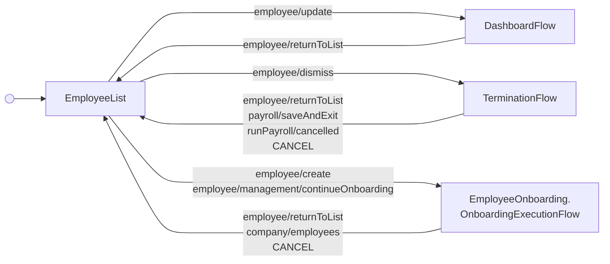

<!-- Partner-facing guide content, published to the SDK docs site. -->

# EmployeeListFlow

## Step flow <!-- slot: appendix -->

The flow rests on the management employee list and routes into one of three sub-flows based on the row action invoked (or the "Add employee" CTA):

- **Edit employee** (`employee/update`) → `DashboardFlow`. Offered on employees who have finished onboarding.
- **Dismiss** (`employee/dismiss`) → `TerminationFlow`
- **Add employee** (`employee/create`) → `OnboardingExecutionFlow`
- **Continue onboarding** or **Review employee** (`employee/management/continueOnboarding`) → `OnboardingExecutionFlow`, opened on the selected employee. Offered on employees who haven't finished onboarding. Review employee first moves an employee who finished self-onboarding into admin review.

Each sub-flow is given a "Back to employees" header that emits `employee/returnToList` to come back to the list. The onboarding sub-flow also returns to the list when it completes (`company/employees`) or is canceled (`CANCEL`). The dismiss sub-flow also returns to the list when an offboarding payroll run inside it is exited (`payroll/saveAndExit`) or cancelled (`runPayroll/cancelled`), or when the dismissal itself is canceled from the termination form (`CANCEL`).

The list itself is tabbed into Active, Onboarding, and Dismissed employees, with per-row actions tailored to each tab. Employees still onboarding get the same actions as the onboarding employee list (continue onboarding, review, cancel self-onboarding, delete).

